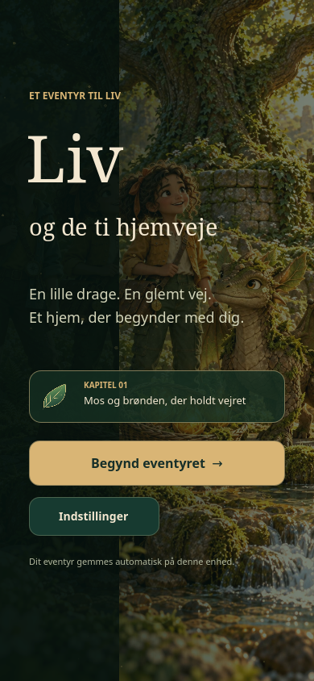
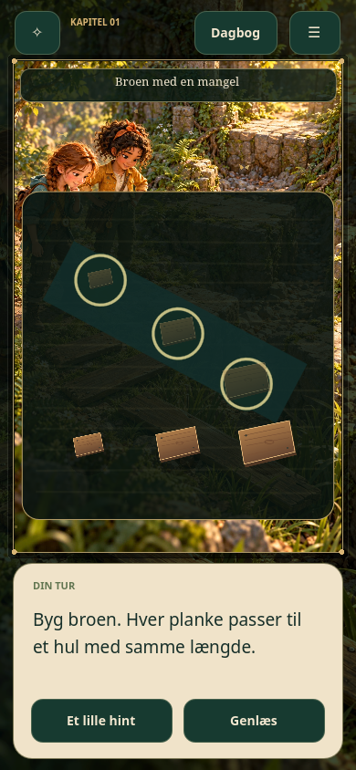
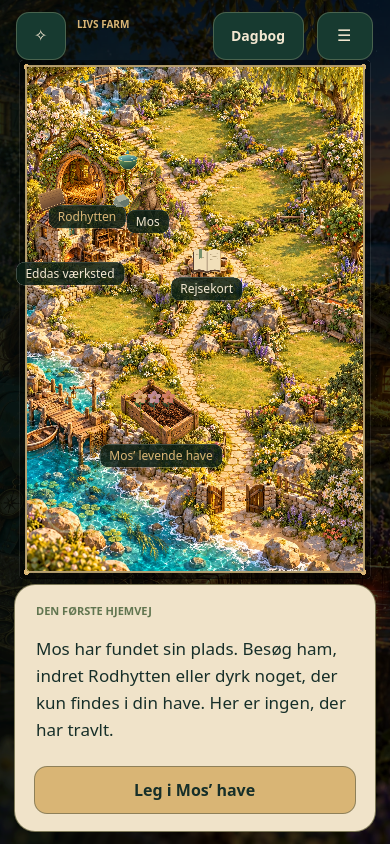
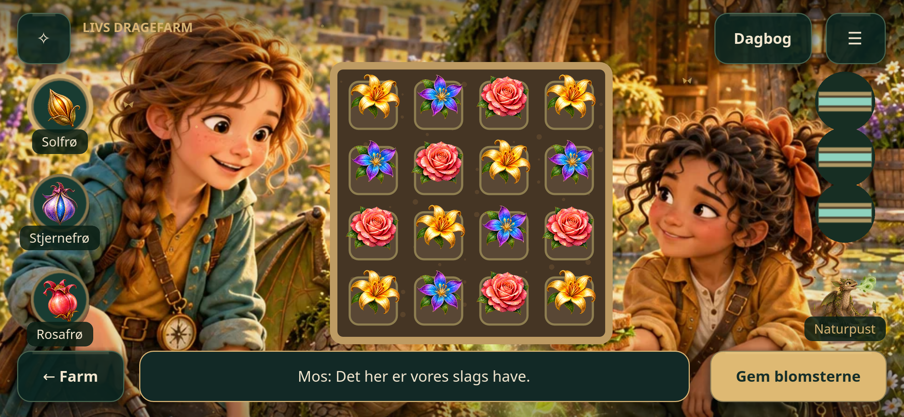

# Liv og de ti hjemveje · Kapitel 1

**[Spil kapitel 1](https://sebastianlistfeirup.github.io/LivHjemveje/)** · **[Hent spilpakken](https://github.com/sebastianlistfeirup/LivHjemveje/raw/refs/heads/gh-pages/LivHjemveje-Kapitel-1-Web.zip)**

Et dansk, illustreret eventyr til Liv: Find kompasset, udforsk lunden med Noor, befri skovdragen Mos og byg hans hjem. Når kapitlet er slut, kan I blive på farmen, indrette Rodhytten og lege i Mos’ levende have.

Kapitel 1 indeholder 40 scener, fire mulige gennemløb, 30 originale illustrationer, interaktive gåder, musik, animationer, automatisk gemning, en vedvarende farm og en haveleg med tre niveauer. De oprindelige replikker og valg er bevaret. Der er ingen pointquiz, tidsfrist, køb eller konto.

<p></p>

## Spil

Åbn [spillet](https://sebastianlistfeirup.github.io/LivHjemveje/) på telefonen. Den verificerede udgave udgives fra grenen `gh-pages`.

Spillet er indrettet til **liggende telefon og iPad**. Telefonen kan også holdes stående; billeder, gåder og tekst flytter sig automatisk, og du kan dreje skærmen midt i spillet. Hjemmeskærmsudgaven følger enhedens orientering. Slå enhedens rotationslås fra, hvis den skal kunne dreje.

Tryk på tingene i billedet. Genstande kan enten trækkes til et mål eller vælges med ét tryk og placeres med det næste. Læs i dit eget tempo. Kompasset åbner rejsekortet, dagbogen gemmer fund og replikker, og menuen har tekststørrelse, rolig bevægelse, lyd og sikkerhedskopier.

Fremgangen gemmes på den enhed og i den browser, du spiller i. Brug **Indstillinger → Eksportér mit eventyr** for at flytte den eller bevare en ekstra kopi. Genbesøg overskriver ikke farmen.

På telefonen: Åbn **Indstillinger → Føj spillet til hjemmeskærmen**. På iPhone/iPad bruges Safari → Del → Føj til hjemmeskærm; på Android bruges browserens installation. Spillet åbner med sit eget Mos-ikon og uden browserens adresselinje. Efter første fulde indlæsning gemmes hele kapitel 1 til spil uden net. Lad spillet hente færdigt, før du går offline. Brug sikkerhedskopien, hvis enheden skifter lagerområde ved installation.

## Kør projektet

Installér **Godot 4.6.3 stable** (standardudgaven, ikke .NET), og åbn `project.godot`. Tryk F6/F5, eller kør:

```bash
godot --path .
```

Byg webversionen med de tilhørende export templates installeret:

```bash
./tools/export_web.sh
python3 -m http.server 8080 --directory builds/web
```

Åbn `http://localhost:8080`. Webeksporten kræver WebGL 2 og bruger ingen backend. Den skal serveres over HTTP(S), ikke åbnes som `file://`.

## Udvikling og kvalitet

- [Teknisk opbygning, gemning og testkommandoer](docs/TEKNIK.md)
- [Færdige dele og konkrete afgrænsninger](docs/STATUS.md)
- [Grafik, lyd og skrifternes oprindelse](assets/PROVENANCE.md)
- [Den oprindelige produktionsbibel](docs/Produktionsbibel-original.md)

`content/source/Spildata.json` er den uændrede fortællingskilde. Runtime-data og præcise handlinger genereres af `tools/make_runtime.py`. `tests/test_chapter.gd` gennemfører alle fire ruter med genindlæsning efter hvert deltrin og kontrollerer farm, genbesøg og alle haveniveauer. `tests/browser.cjs` spiller med rigtige mus-/touchhændelser i en debug-webeksport.

De 30 sceneillustrationer ligger i projektet som WebP. De store originalfiler og produktionsmaterialet kan fortsat hentes fra udviklingspakken nedenfor. Kapitel 2–10 er ikke spilbare i denne udgave.

---

## Start her: Liv og de ti hjemveje

Den originale udviklingspakke ligger i [release v1.0](https://github.com/sebastianlistfeirup/LivHjemveje/releases/tag/v1.0).

**[Download den komplette PDF](https://github.com/sebastianlistfeirup/LivHjemveje/releases/download/v1.0/Liv_og_de_ti_hjemveje_KOMPLET_CODEX_PAKKE.pdf)** — 549 sider, 117.005.562 bytes.

PDF'en indeholder bibel, manuskript, replikker, gameplay og billedplaner til alle 10 kapitler. Kapitel 1 har 30 færdige scenebilleder og en figurreference. Billederne til kapitel 2–10 er beskrevet, men endnu ikke genereret.

## Til Codex

PDF'en ligger som releasefil og følger ikke med en almindelig git-clone. Hent PDF'en fra linket ovenfor; GitHubs automatiske "Source code"-arkiver er ikke udviklingspakken.

PDF'en indeholder den indlejrede `Codex_Input.zip` med de originale PNG-billeder, manuskripter, produktionsbibel, JSON-spildata og valideringsværktøj. Udpak den før udvikling, så materialet kan læses og bruges som almindelige filer.

Kør fra repoets rod:

```bash
python3 -m pip install pymupdf
python3 - <<'PY'
from pathlib import Path
from urllib.request import urlretrieve
from hashlib import sha256
from io import BytesIO
from zipfile import ZipFile
import fitz

pdf_path = Path("Liv_og_de_ti_hjemveje_KOMPLET_CODEX_PAKKE.pdf")
url = "https://github.com/sebastianlistfeirup/LivHjemveje/releases/download/v1.0/Liv_og_de_ti_hjemveje_KOMPLET_CODEX_PAKKE.pdf"
if not pdf_path.exists():
    urlretrieve(url, pdf_path)
expected = "418c882b07ffe5fb2ed9ef66040a2f2e2fdbdec0c27532a585719b157314c1ea"
if sha256(pdf_path.read_bytes()).hexdigest() != expected:
    raise SystemExit("PDF-kontrolsum stemmer ikke. Hent filen igen.")
with fitz.open(pdf_path) as pdf:
    sources = pdf.embfile_get("Codex_Input.zip")
with ZipFile(BytesIO(sources)) as archive:
    archive.extractall("liv_kilder")
print("Kilder udpakket til liv_kilder/Codex_Input")
PY
python3 liv_kilder/Codex_Input/tools/validate_package.py
```

Læs derefter:

1. `liv_kilder/Codex_Input/START_HER.md`
2. `liv_kilder/Codex_Input/docs/Produktionsbibel.md`
3. `liv_kilder/Codex_Input/data/Spildata.json`
4. Kapitel 1-manuskriptet og billederne i `liv_kilder/Codex_Input/assets/chapter_01/`.

Begynd med en spilbar udgave af kapitel 1 med de medfølgende replikker, valg, visuelle gåder og hjemkomst til dragefarmen. Følg biblen for mobilbetjening, animationer og progression.

Dette er udviklingsmaterialet. Et færdigt spil, separate animationslag og indtalt lyd er endnu ikke inkluderet. Bevar originalmaterialet som reference; læg implementeringen i projektets egne filer. Den store PDF skal fortsat ligge som releasefil frem for at blive committed til almindelig Git.
